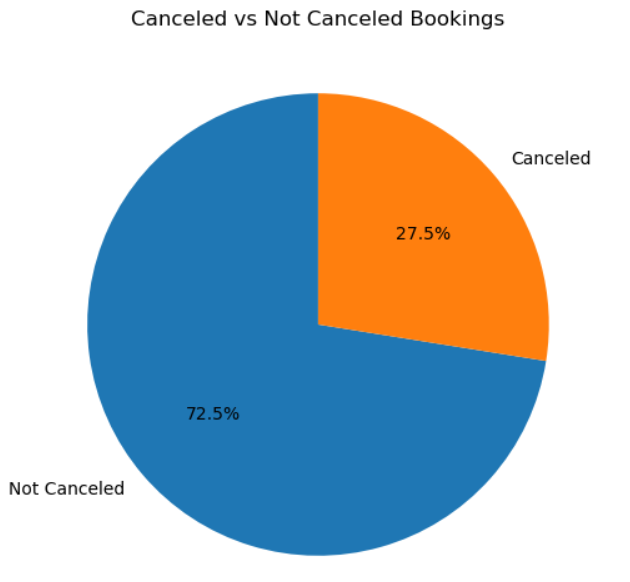
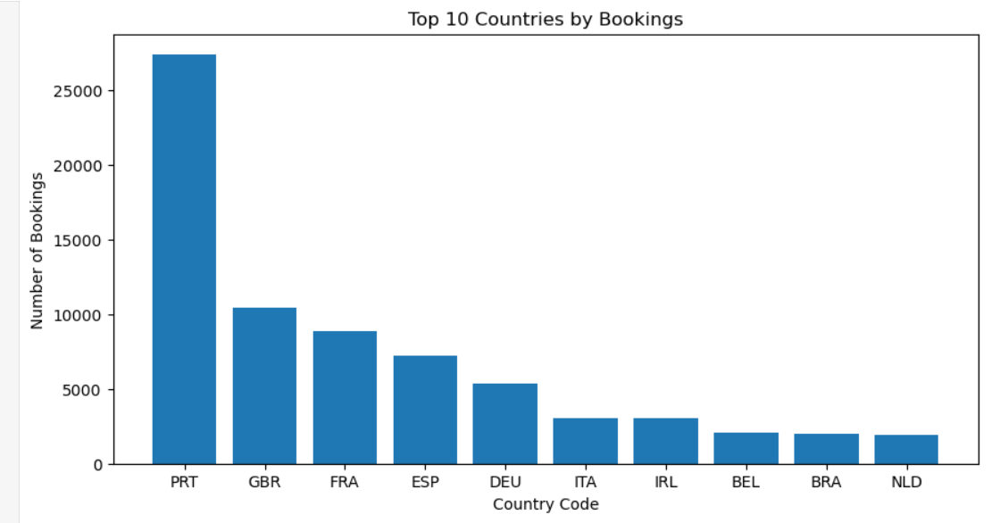

# Hotel Bookings - Exploratory Data Analysis (EDA)

**Hotel Harmony: Data Insights for Optimized Operations**

This project is an exploratory data analysis of hotel booking data for a fictional company, **Elite Hotels International**. The aim is to understand booking patterns, cancellations, pricing and guest behaviour so that management can make better decisions on operations, marketing and revenue.

---

## Table of Contents
1. [Project Overview](#project-overview)
2. [Problem Statement](#problem-statement)
3. [Dataset](#dataset)
4. [Repository Structure](#repository-structure)
5. [Requirements](#requirements)
6. [Tools and Technologies](#tools-and-technologies)
7. [Project Workflow](#project-workflow)
8. [Visualizations](#visualizations)
9. [Key Insights](#key-insights)
10. [Challenges Faced](#challenges-faced)
11. [Recommendations](#recommendations)
12. [How to Run This Project](#how-to-run-this-project)
13. [Author](#author)

---

## Project Overview

Elite Hotels International has hotels in different locations and has been facing challenges in managing its booking patterns and customer satisfaction. Management decided to analyze its booking data to find insights that can drive strategic decisions.

I worked as the data analyst on this project. I cleaned the data, answered the case study questions step by step in a Jupyter notebook, and wrote down the findings and recommendations.

**Main goals**
- Understand when guests book, when they arrive and how long they stay
- Find out how many bookings are cancelled and what causes cancellations
- Compare the two hotel types, booking channels, market segments and countries
- Study the average daily rate (ADR) and revenue across months and years
- Give practical recommendations to management

**Stakeholders:** management team, operations team, marketing team, customer service team, guests, travel agencies and suppliers.

---

## Problem Statement

Elite Hotels International needs to optimize its booking patterns and improve customer satisfaction to stay competitive. Solving this will help to:
- improve operational efficiency
- increase guest satisfaction and loyalty
- increase revenue through better resource allocation and marketing

The full case study (background, data dictionary, stakeholders and all questions) is in `Problem_Statement.docx`.

---

## Dataset

- **Source:** [Hotel Booking Demand - Kaggle](https://www.kaggle.com/jessemostipak/hotel-booking-demand)
- **Reference article:** [Hotel booking demand datasets - ScienceDirect](https://www.sciencedirect.com/science/article/pii/S2352340918315191)
- **File:** `hotel_bookings.csv`
- **Size:** 119,390 rows and 32 columns (87,228 bookings after cleaning)
- **Period:** July 2015 to August 2017
- **Hotels:** City Hotel and Resort Hotel

**Main columns:** `hotel`, `is_canceled`, `lead_time`, `arrival_date_year / month / day`, `stays_in_weekend_nights`, `stays_in_week_nights`, `adults`, `children`, `babies`, `meal`, `country`, `market_segment`, `distribution_channel`, `is_repeated_guest`, `previous_cancellations`, `reserved_room_type`, `booking_changes`, `deposit_type`, `agent`, `company`, `days_in_waiting_list`, `customer_type`, `adr`, `required_car_parking_spaces`, `total_of_special_requests`, `reservation_status`.

---

## Repository Structure

```
hotel-booking-demand-eda/
│
├── .gitignore
├── Bookings_ratio.png.png        # Chart: canceled vs not canceled bookings
├── Countries_Bookings.png.png    # Chart: top 10 countries by bookings
├── Hotel_Bookings_EDA.ipynb      # Complete analysis (cleaning, EDA, insights)
├── Problem_Statement.docx        # Case study and all questions
├── README.md                     # Project documentation (this file)
├── hotel_bookings.csv            # Dataset
└── requirements.txt              # Python libraries needed
```

---

## Requirements

- Python 3.8 or higher
- Jupyter Notebook (or JupyterLab / VS Code with the Jupyter extension)
- Libraries (listed in `requirements.txt`):
  - pandas
  - numpy
  - matplotlib
  - scikit-learn (used for the logistic regression and linear regression questions)

Install them with:

```bash
pip install -r requirements.txt
```

---

## Tools and Technologies

| Tool | Use |
|---|---|
| Python | Main programming language |
| Pandas | Data cleaning, grouping, filtering and calculations |
| NumPy | Numerical operations |
| Matplotlib | Bar charts, pie chart, histograms, line charts, scatter plot and box plot |
| Scikit-learn | Logistic regression (cancellation factors) and linear regression (ADR vs guests) |
| Jupyter Notebook | Writing code and explanations together |
| Git and GitHub | Version control and sharing the project |

---

## Project Workflow

**1. Understanding the data**
Checked the first and last rows, shape, columns, data types and summary statistics.

**2. Data cleaning**
- Removed 31,994 duplicate rows
- Filled missing values: `children` with 0, `country` with "Unknown", and `agent` / `company` with 0 (meaning no agent or company was used)
- Converted the month names and day/year columns into one proper arrival date, and converted `reservation_status_date` to a date
- Removed 2 rows with wrong prices (one negative ADR and one ADR of 5400) and 166 bookings that had no guests at all
- Created new columns: `total_stay`, `total_guests` and `revenue` (ADR x nights)

**3. Analysis**
Answered 10 basic, 10 medium and 5 advanced questions, each with a chart or table and a short written insight. Topics include lead time, hotel type, cancellations, arrival months, special requests, countries, ADR, parking, length of stay, travel agents, market segments, distribution channels, ADR trend, revenue by month, repeated guests, room types, logistic regression for cancellation factors, ADR vs number of guests, seasonal cancellations and lead time by market segment.

**4. Findings and recommendations**
Summarized the key findings, gave recommendations for management and listed areas for further investigation.

---

## Visualizations

### Canceled vs Not Canceled Bookings



More than 1 in every 4 bookings (27.5%) was canceled.

### Top 10 Countries by Bookings



Portugal (PRT) is by far the biggest source of bookings, followed by the United Kingdom (GBR), France (FRA), Spain (ESP) and Germany (DEU).

---

## Key Insights

**Bookings and guests**
- The average lead time is **80 days**, but the median is only **49 days** - many guests book close to the arrival date.
- The **City Hotel** gets 61% of the bookings and the **Resort Hotel** 39%.
- **Portugal** is the top country with 31% of all bookings. The top 5 countries (Portugal, UK, France, Spain, Germany) make up 68%.
- **TA/TO** (travel agents and tour operators) is the biggest booking channel (79%), and about **86%** of all bookings come through an agent.
- The average stay is about **3.6 nights**, only **8.4%** of bookings need parking and the average booking has **0.70** special requests.
- Only **3.9%** of bookings are from repeated guests. They cancel far less (7.7% vs 28.3% for new guests).

**Cancellations**
- **27.5%** of bookings were cancelled.
- The **City Hotel** has a higher cancellation rate (**30.1%**) than the **Resort Hotel** (**23.5%**).
- The longer the lead time, the more cancellations: bookings made within a week are cancelled about 8% of the time, bookings made more than a year ahead about 41%.
- The logistic regression shows that long lead time, higher ADR and previous cancellations increase the chance of cancellation, while parking needs, special requests, booking changes and being a repeated guest reduce it.
- 'Non Refund' bookings show a very high cancellation rate (95%), which looks unusual and needs to be checked.
- Cancellations are highest in **August** (32.2%) and lowest in **November** (21.2%).

**Pricing and revenue**
- The average ADR is **111.17** for the City Hotel and **99.06** for the Resort Hotel.
- **August** is the highest revenue month, and summer is the peak season (also confirmed using 2016, the only full year).
- Prices are rising every year: for July-August the average ADR went from 119 (2015) to 141 (2016) to 158 (2017).
- Online TA and Direct guests pay the highest rates. Guests with more special requests also pay more.
- Each extra adult adds about 33 and each extra child about 38 to the nightly rate.

**Lead time by market segment**
- Groups book the earliest (median 115 days), while direct, corporate and aviation guests book very late (15, 5 and 3 days).

---

## Challenges Faced

1. **Many duplicate rows:** 31,994 rows (about 27% of the data) were exact duplicates and had to be removed before any analysis.
2. **Missing values:** `agent` and `company` were mostly empty because many bookings are made without an agent or a company. I filled them with 0 so that the columns could still be used. A few missing `children` and `country` values were also handled.
3. **Dates in separate columns:** The arrival date was split into year, month (as a name) and day, so I had to convert the month name into a number and build one proper date.
4. **Wrong values:** One booking had a negative price, one had an ADR of 5400, and 166 bookings had no adults, children or babies. These were removed. ADR values of 0 were kept, because they are mostly complimentary stays.
5. **Uneven time coverage:** The data runs from July 2015 to August 2017, so July and August appear in three years and the other months in only two. This could make July and August look bigger, so I double-checked the monthly results with 2016, which is the only full year.
6. **Defining revenue:** The hint suggested summing ADR, which is not real revenue. I calculated revenue as ADR x nights stayed for non-cancelled bookings, and also checked the hint's method.
7. **No satisfaction score:** The data has no guest satisfaction column, so special requests were used as a rough measure of guest engagement, as suggested by the case study.
8. **Skewed data and outliers:** Lead time, ADR and number of guests have extreme values. I used medians, limited the guest numbers for the regression and hid outliers in the box plot to keep the charts readable.
9. **Confusing deposit data:** Non-refundable bookings are cancelled 95% of the time, which is the opposite of what is expected. I reported it as something for management to investigate and did not try to explain it.

---

## Recommendations

**For management**
1. **Reduce cancellations on long lead-time bookings** by asking for a deposit, sending reconfirmation messages or giving a small discount for confirming closer to the date.
2. **Focus on the City Hotel's cancellation problem** with stricter policies and a controlled overbooking plan.
3. **Prepare for the summer peak** with enough staff, rooms and supplies, and run promotions in the slow winter months to fill rooms.
4. **Use dynamic pricing** based on season, room type and number of guests, since prices are already rising each year and families pay more per night.
5. **Keep strong relationships with travel agents and tour operators** because they bring most of the bookings.
6. **Target the top countries** (Portugal, UK, France, Spain and Germany) with focused marketing.
7. **Build a loyalty programme** - only 3.9% of bookings are from repeated guests, and they cancel far less.
8. **Review the deposit policy**, especially for non-refundable bookings.
9. **Use different marketing timing for each segment:** early offers for groups and tour operators, last-minute offers for direct and corporate guests.
10. **Keep booking changes easy**, as guests who change bookings do not seem less engaged.

**Areas for further investigation**
- Why non-refundable bookings are cancelled so often
- The reasons behind the higher cancellation rate at the City Hotel
- A prediction model that flags high-risk bookings before they are cancelled
- Guest feedback or review data to measure real satisfaction

---

## How to Run This Project

1. Clone the repository
   ```bash
   git clone https://github.com/ShubhamShah1/hotel-booking-demand-eda.git
   cd hotel-booking-demand-eda
   ```
2. Install the libraries
   ```bash
   pip install -r requirements.txt
   ```
3. Open the notebook (the dataset `hotel_bookings.csv` is already in the folder)
   ```bash
   jupyter notebook Hotel_Bookings_EDA.ipynb
   ```
4. Run all the cells (Kernel > Restart & Run All).

---

## Author

**Shubham Shah**  
GitHub: [ShubhamShah1](https://github.com/ShubhamShah1)

If you liked this project, please give it a star.
